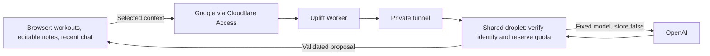

# 014 — Invite-only hosted Coach

Uplift builds the existing openGym coaching payload in the browser after consent. The droplet runs the existing proposal validator. The lifter reviews changes before applying them.

Open **Plan → Coach → Notes** to edit up to 600 characters. Full profile backups and sync include notes and chat. The origin persists usage counts only. Deploy owns the invite list, tunnel and provider credential.
